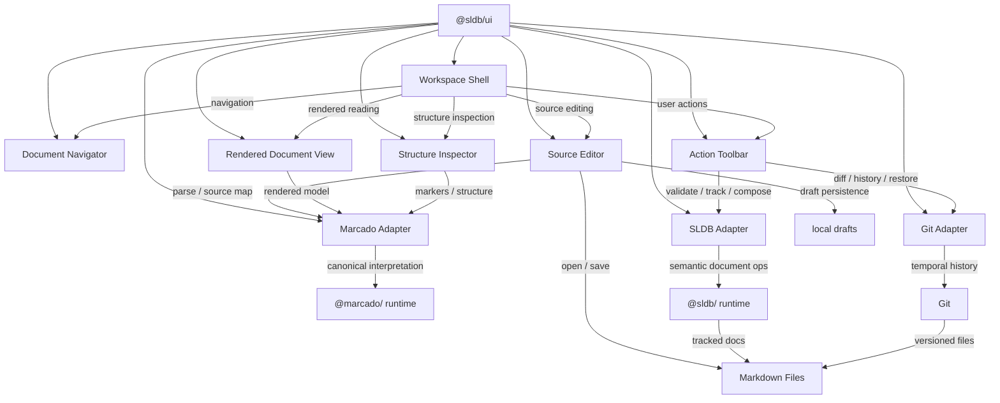

# SLDB UI diagrams

These diagrams were authored as structured specs and rendered with `spec2viz`.

## Files

### Component architecture

- Spec: `docs/diagrams/spec/sldb-ui-components.yml`
- Rendered Mermaid: `docs/diagrams/out/sldb-ui-components.mmd`

### UI view matrix

- Spec: `docs/diagrams/spec/sldb-ui-views.yml`
- Rendered Vega: `docs/diagrams/out/sldb-ui-views.vega.json`

## Component diagram



## UI view matrix

The UI view diagram is modeled as a `component_view_matrix` because the important question is not only *what components exist*, but also *which UI surfaces are active in which view/stage*.

### Views modeled

- **Onboarding**: start, open-doc, sample-doc
- **Editing Workspace**: navigate, source, rendered, inspect, act
- **Persistence**: draft, save-file, export
- **Integration**: refresh-runtime, validate-doc, review-diff

### Main mapping

- **EntrySurface** owns the onboarding views
- **Workspace** owns the editing, persistence, and most interaction views
- **Adapters** activate in integration views:
  - `MarcadoAdapter` during runtime refresh
  - `SldbAdapter` during validation flows
  - `GitAdapter` during diff/history review

To visualize the matrix fully, open:

- `docs/diagrams/out/sldb-ui-views.vega.json`

or regenerate both outputs with:

```bash
spec2viz validate docs/diagrams/spec/sldb-ui-components.yml
spec2viz validate docs/diagrams/spec/sldb-ui-views.yml
spec2viz render docs/diagrams/spec/sldb-ui-components.yml --backend mermaid --out docs/diagrams/out
spec2viz render docs/diagrams/spec/sldb-ui-views.yml --out docs/diagrams/out
```
